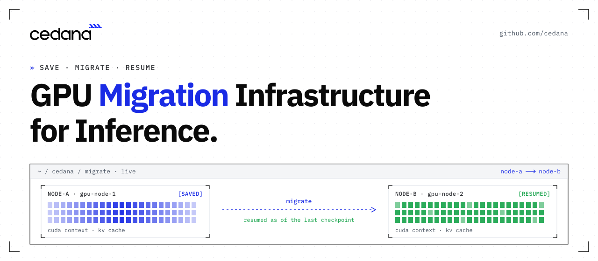

<p align="center">
  
</p>

[](https://github.com/cedana/cedana/releases) [](https://github.com/cedana/cedana/actions/workflows/push.yml) [](LICENSE.md)

[Docs](https://docs.cedana.ai/daemon) | [Kubernetes install](https://docs.cedana.ai/cedana-kubernetes/installation) | [Slurm install](https://docs.cedana.ai/cedana-slurm/installation) | [Samples](https://github.com/cedana/cedana-samples) | [Benchmarks](https://cedana.com/benchmarks/) | [Blog](https://cedana.com/blog/) | [Website](https://cedana.com)

Cedana is automated GPU checkpointing and migration infrastructure that increases the useful work your GPUs deliver. By preserving full workload state (CUDA context, KV cache) transparently across multi-GPU and multi-node jobs, Cedana increases effective GPU utilization, makes cold starts faster and predictable, and resumes workloads automatically on failure with no work lost.

This repository is the Cedana daemon: the service that runs on each node, and the `cedana` command-line tool that talks to it. The daemon checkpoints and restores processes and containers. It uses [CRIU](https://github.com/checkpoint-restore/criu) for the CPU side, and plugins for container runtimes, Kubernetes, Slurm and checkpoint storage. You can also run it on its own, as a checkpoint and restore tool for one machine.

What is open source here, and what needs a Cedana account:

| Part | Where | Access |
|---|---|---|
| Daemon, CLI and the plugins in [plugins/](plugins/) | This repo | Open source, AGPL-3.0. You can [build the plugins locally](https://docs.cedana.ai/daemon/get-started/plugins). |
| Released plugins from Cedana's plugin registry, including the GPU plugin | `sudo cedana plugin install <name>` | Needs a Cedana account ([authentication](https://docs.cedana.ai/daemon/get-started/authentication)) |
| Kubernetes install: a controller and a node helper | [cedana-helm-charts](https://github.com/cedana/cedana-helm-charts) | The chart is public. The install needs a Cedana URL, auth token and cluster ID. |
| Managed platform: policy, automation and the UI | [cedana.com](https://cedana.com) | Cedana account |

## News

- **16 Oct 2026** [v0.9.400](https://github.com/cedana/cedana/releases/tag/v0.9.400): adds a podman plugin, so containers that podman runs can be checkpointed and restored.
- **7 Oct 2026** [v0.9.309](https://github.com/cedana/cedana/releases/tag/v0.9.309): adds CRIU plugins for NVIDIA device files and InfiniBand, so processes that hold open `/dev/nvidia*` or `/dev/infiniband/*` files can be checkpointed.
- **30 Sep 2026** [Serve a portfolio of coding models on a single node with NVIDIA Dynamo, NeMo Switchyard and Cedana](https://cedana.com/blog/coding-model-portfolio-single-node/)
- **24 Sep 2026** [v0.9.305](https://github.com/cedana/cedana/releases/tag/v0.9.305): supports Slurm 26 cgroup names.
- **11 Sep 2026** [What Cedana saves in a checkpoint, and its limits](https://cedana.com/blog/what-cedana-saves/)
- **7 Sep 2026** [Cedana installation: what changes on your cluster](https://cedana.com/blog/cedana-installation-cluster-changes/)
- **31 Aug 2026** [How Cedana checkpoint and restore works](https://cedana.com/blog/how-cedana-checkpoint-restore-works/)

## The problem

When a node running a GPU job goes away and nothing underneath the job saved what it was doing, the job starts again from the beginning. Everything it had built up in GPU memory is gone. A spot reclaim, a Kubernetes eviction, a node drain for maintenance, a Slurm time limit, an out-of-memory kill and a failed GPU all end the same way.

Starting again is slow for large models. Cold starts for frontier open-weight models run from 10 minutes to as long as 60 in production.

The usual fix is a checkpoint path written inside the application. It covers that one program, and somebody has to keep it working. A serving engine's running state (weights in GPU memory, compiled CUDA graphs, the KV cache of every session) is rebuilt on every start.

## How Cedana works

The daemon runs on every node, below the serving engine and the container runtime. Nothing above it changes.

To checkpoint a running job, Cedana:

1. Tracks the GPU side while the process runs, by interposing at the CUDA driver API: device memory, the CUDA context, streams and compiled graphs.
2. For a job on several GPUs in one node, stops every GPU at the same point in the computation, so the saved state agrees across GPUs. Jobs that coordinate through NCCL use `--gpu-freeze-type nccl`.
3. Hands the process to CRIU, which saves the CPU side: process memory, threads, open files and sockets.
4. Saves the container's files, what the scheduler needs to resume the job and, for a serving worker, the KV cache.
5. Writes the checkpoint to local disk or to checkpoint storage: Amazon S3, Cedana storage or CSX.

To restore, Cedana:

1. Uses the checkpoint only on a node with the same GPU, driver, engine and model versions it recorded. If any of them changed, the workload starts cold instead.
2. Puts the process and GPU state back, and the job continues from the moment of the checkpoint.

A migration is a restore on a different node. The same steps run under Kubernetes (a Helm chart, and one environment variable per workload) and under Slurm (a plugin, with `sbatch`, `srun`, `squeue` and `scancel` unchanged).

More detail: [How Cedana checkpoint and restore works](https://cedana.com/blog/how-cedana-checkpoint-restore-works/) and the [architecture guide](docs/developer-guides/architecture.md).

## What Cedana supports

Tested in CI: the regression suite on amd64 and arm64, GPU tests with CUDA 12.8 and 13.2, and Kubernetes tests on K3s, EKS, EKS with Karpenter, GKE and Nebius.

### Job shapes

The single-GPU and multi-GPU-on-a-single-node tiers ship in production today. Multi-node, where a single workload spans hundreds or thousands of GPUs across many nodes, is in design partnership with leading enterprises and neoclouds.

| Shape | Status |
|---|---|
| One GPU | Ships in production |
| Several GPUs in one node | Ships in production |
| A job moved from one node to another | Ships (the job runs on one node at a time) |
| One job whose GPUs sit in several nodes at the same time | In design partnership with leading enterprises and neoclouds: [details](https://cedana.com/blog/cedana-multi-node-checkpointing/) |

### Container runtimes and VMs

From [`cedana features`](docs/get-started/features.md). ✔ means implemented.

| Runtime | Checkpoint | Restore | Run and manage | GPU | Notes |
|---|---|---|---|---|---|
| runc | ✔ | ✔ | ✔ | ✔ | |
| crun | ✔ | ✔ | ✔ | ✔ | |
| containerd | ✔ | ✔ | ✔ | ✔ | Needs the runc or crun plugin underneath. Restore is covered by the regression tests. |
| podman | ✔ | ✔ | ✔ | ✔ | Needs the crun or runc plugin and cedana-oci-runtime |
| CRI-O | | | | | Not supported yet ([plugins/crio](plugins/crio/README.md)) |
| Kata Containers | VM level | VM level | | | From `cedana features` |
| Cloud Hypervisor | VM level | VM level | | | From `cedana features` |

### Orchestrators

| Orchestrator | How Cedana installs | Versions tested | What changes in a workload |
|---|---|---|---|
| Kubernetes | [Helm chart](https://github.com/cedana/cedana-helm-charts): a controller and a node helper DaemonSet | K3s, EKS, EKS with Karpenter, GKE and Nebius in CI | One env var, `CEDANA_CHECKPOINT`. GPU pods also set `runtimeClassName: cedana`. |
| Slurm | An installer registers Cedana's task, SPANK, cli filter and job submit plugins. No Slurm rebuild. The installer restarts `slurmctld` and `slurmd` when it finishes ([docs](https://docs.cedana.ai/cedana-slurm/installation)). | Slurm 26 cgroup names since v0.9.305 | One line: `#SBATCH --export=CEDANA_ENABLE=1` |

### GPUs and drivers

| | Cedana GPU plugin | CRIU CUDA plugin |
|---|---|---|
| GPU vendor | NVIDIA | NVIDIA |
| Driver versions | 452 to 570 ([docs](https://docs.cedana.ai/daemon/checkpoint-restore/gpu)) | 570 only ([docs](https://docs.cedana.ai/daemon/checkpoint-restore/gpu)) |
| Tested in CI | CUDA 12.8 and 13.2 | |
| Several GPUs in one node | Yes | Yes |
| Several processes | Yes | No |
| CPU architecture | amd64, arm64 | amd64 |
| Access | Needs a Cedana account | Open source, from the CRIU community |

### Serving engines

Cedana runs below the engine, so the engine and the application code do not change.

| Engine | Runs under Cedana | Restore correctness test |
|---|---|---|
| SGLang | Yes | On file |
| TensorRT-LLM | Yes | On file |
| NVIDIA Dynamo | Yes, see the [integration guide](https://docs.cedana.ai/cedana-inference/deploying-with-dynamo) | |

### Checkpoint storage

| Backend | Plugin | Notes |
|---|---|---|
| Local disk | built in | |
| Amazon S3 | `storage/s3` | Static keys (default), EKS Pod Identity or the AWS default credential chain |
| Cedana storage | `storage/cedana` | Managed by Cedana. Needs an account. |
| CSX (Cedana Storage Express) | `storage/csx` | Cedana's NFS-backed storage. Needs an account and a local CSX daemon. |

### Platform

Linux on amd64 and arm64. The daemon needs root. Cedana ships a modified CRIU as a plugin: `sudo cedana plugin install criu`.

## Quick start

### On one machine (the open-source daemon)

Install CRIU's build dependencies and the latest release (Ubuntu or Debian shown; see [installation](https://docs.cedana.ai/daemon/get-started/installation) for dnf and for building from source), then start the daemon:

```sh
sudo apt-get install -y libnet-dev libprotobuf-c-dev libnl-3-dev libbsd-dev libcap-dev libseccomp-dev libgpgme11-dev libnftables-dev
curl -fsSL https://github.com/cedana/cedana/releases/latest/download/install-release.sh | sudo -E bash
sudo cedana daemon start
```

Download a small test workload from this repo. It prints the date every second:

```sh
curl -fsSLO https://raw.githubusercontent.com/cedana/cedana/main/test/workloads/date-loop.sh
chmod +x date-loop.sh
```

Run it as a Cedana job with the job ID `quickstart`. `--attach` keeps this terminal connected to the job. Leave it running and open a second terminal for the next steps.

```sh
cedana run process --attach --jid quickstart -- ./date-loop.sh
```

In the second terminal, list the jobs:

```sh
cedana ps
```

```
JOB         TYPE     PID    STATUS  GPU  CHECKPOINT  SIZE  LOG
quickstart  process  32646  sleep   no                     [Attachable]
```

Checkpoint the job, then list the jobs again:

```sh
cedana dump job quickstart
cedana ps
```

```
JOB         TYPE     PID    STATUS  GPU  CHECKPOINT     SIZE     LOG
quickstart  process  32646  halted  no   2 seconds ago  644 KiB
```

Restore the job. The terminal you run this in is attached to the restored job:

```sh
cedana restore job --attach quickstart
```

GPU jobs need the GPU plugin and a Cedana account: see [checkpoint and restore with GPUs](https://docs.cedana.ai/daemon/checkpoint-restore/gpu).

### On Kubernetes

Register the cluster with Cedana to get a cluster ID, then install the chart:

```sh
export CEDANA_AUTH_TOKEN=<your-auth-token>
export CEDANA_CLUSTER_ID=<cluster_id>
export CEDANA_URL=<your-org-url>
helm upgrade -i cedana oci://registry-1.docker.io/cedana/cedana-helm \
  --create-namespace -n cedana-system \
  --set=config.clusterId=$CEDANA_CLUSTER_ID \
  --set=config.url=$CEDANA_URL \
  --set=config.authToken=$CEDANA_AUTH_TOKEN
```

Opt a workload in with one environment variable. GPU pods also set `runtimeClassName: cedana`.

```yaml
env:
  - name: CEDANA_CHECKPOINT
    value: my-workload
```

### On Slurm

One setup script covers the cluster: run the same installer on every node, each time with that node's role. The installer restarts `slurmctld` and `slurmd` when it finishes.

```sh
export CEDANA_URL=<your-org-url>
export CEDANA_AUTH_TOKEN=<your-auth-token>
export CEDANA_CLUSTER_ID=<cluster_id>
curl -fsSL "${CEDANA_URL}/install/slurm" -H "Authorization: Bearer ${CEDANA_AUTH_TOKEN}" | sudo -E bash -s -- --node-role <controller|worker|login>
```

Opt a job in with one line in its batch script:

```sh
#SBATCH --export=CEDANA_ENABLE=1,CEDANA_CHECKPOINT=my-job
```

The output shown is from Cedana's docs. Job IDs and PIDs differ on your machine.

## Limits

- **One job across several nodes is not supported yet.** The single-GPU and multi-GPU-on-a-single-node tiers ship in production today. Multi-node, where a single workload spans hundreds or thousands of GPUs across many nodes, is in design partnership with leading enterprises and neoclouds.
- **A checkpoint restores only where versions match.** A checkpoint records the GPU, driver, engine and model versions it was taken against. If any of them changes, the checkpoint is invalid and the workload cold-starts instead.
- **Effects outside the machine do not roll back.** A tool call that went out, a database row that was written or an email that was sent stays done, and the work after the checkpoint runs again. Your application handles the calls that are not safe to repeat.
- **Some processes cannot be checkpointed:** a process holding a raw hardware device other than the GPU, a process under a debugger, or a process holding a file that belongs to something outside what is being saved.
- **NVIDIA GPUs only.**
- **Root is required.** The daemon needs root. On Kubernetes, the helper DaemonSet runs with privilege escalation and installs the daemon on the host.
- **Released plugins need a Cedana account,** including the GPU plugin.
- **A failure loses the work since the last checkpoint.** Checkpoints run on an interval the operator sets.

Full list: [docs/limitations.md](docs/limitations.md) and [GPU checkpointing limits: what cannot be saved?](https://cedana.com/blog/gpu-checkpointing-limitations/)

## If you are wiring CRIU and cuda-checkpoint together yourself

CRIU does not checkpoint a process that holds a GPU on its own. CRIU's CUDA plugin closes part of that gap: it calls NVIDIA's [cuda-checkpoint](https://github.com/NVIDIA/cuda-checkpoint), which suspends one process's CUDA state, so CRIU can save the rest. That pairing is real and maintained, and the Cedana daemon can use it (see the GPU table above). This is what it leaves to you, and what Cedana adds:

| You build and run | Cedana |
|---|---|
| Checkpointing one process at a time | Holds every GPU of one job, on one node, at the same point before saving |
| Creating, storing, moving and retiring checkpoints for every model and configuration | Writes checkpoints to local disk, S3, Cedana storage or CSX, and restores them where versions match |
| Saving the container's files, network connections and scheduler state around the process | Saves them with the process |
| Testing each engine and each engine release | Runs below SGLang and TensorRT-LLM with no engine change, with a restore correctness test on file for each |
| Deciding when to checkpoint and where to restore | Policies on the Cedana platform automate checkpoints and restores ([Kubernetes](https://docs.cedana.ai/cedana-kubernetes/automation), [Slurm](https://docs.cedana.ai/cedana-slurm/automation)) |

Read more: [CRIU GPU checkpointing with cuda-checkpoint](https://cedana.com/blog/criu-gpu-checkpointing/)

## Benchmarks

Restore time follows the size of the checkpoint, meaning how many bytes have to move, not the parameter count.

Frontier models from 229B to 1.6T parameters restore in 57 to 70 seconds on 8x B200 with Cedana, where a native start takes 9 to 34 minutes. Served with SGLang on one node:

| Model | Parameters | Checkpoint | Native start | Cedana restore | Speedup |
|---|---|---|---|---|---|
| MiniMax-M2.7 | 229B | 244 GiB | 564 s | 57 s | 9.9x |
| GLM-5.2-FP8 | 753B | 734 GiB | 1,322 s | 61 s | 21.7x |
| Kimi-K2.6 | 1.1T | 670 GiB | 1,217 s | 63 s | 19.3x |
| DeepSeek-V4-Pro | 1.6T | 873 GiB | 2,051 s | 70 s | 29.3x |

Other results:

- FLUX image generation on 8x B200: cold start from 50 minutes to 73 seconds.
- [Coding portfolio](https://cedana.com/benchmarks/coding-portfolio-rtxpro6000/) on 8x RTX PRO 6000: 2.1x faster and 52% lower compute cost.

Cedana's steady-state overhead is under 2%, often closer to zero.

Method and configuration for every number: [cedana.com/benchmarks](https://cedana.com/benchmarks/) ([8x B200 LLM cold starts](https://cedana.com/benchmarks/llm-cold-start-8xB200/), [FLUX](https://cedana.com/benchmarks/flux-cold-start-8xB200/))

## Guides and examples

- Runnable workloads: [cedana-samples](https://github.com/cedana/cedana-samples) (CPU, GPU, Kubernetes and Slurm examples).
- Daemon guides: [basics](https://docs.cedana.ai/daemon/checkpoint-restore/basics), [GPUs](https://docs.cedana.ai/daemon/checkpoint-restore/gpu), [runc](https://docs.cedana.ai/daemon/checkpoint-restore/runc), [crun](https://docs.cedana.ai/daemon/checkpoint-restore/crun), [containerd](https://docs.cedana.ai/daemon/checkpoint-restore/containerd), [podman](https://docs.cedana.ai/daemon/checkpoint-restore/podman), [storage on S3](https://docs.cedana.ai/daemon/storage/s3).
- Kubernetes: [checkpoint and restore](https://docs.cedana.ai/cedana-kubernetes/cr), [jobs that resume after a restart](https://docs.cedana.ai/cedana-kubernetes/jobs).
- Slurm: [checkpoint and restore](https://docs.cedana.ai/cedana-slurm/cr), [unprivileged mode](https://docs.cedana.ai/cedana-slurm/unprivileged-mode-non-root).
- Inference: [deploying with NVIDIA Dynamo](https://docs.cedana.ai/cedana-inference/deploying-with-dynamo).

## Getting help

- Bugs and feature requests: [GitHub Issues](https://github.com/cedana/cedana/issues). Include your environment, what you ran and the daemon logs.
- Security problems: see the [security policy](https://github.com/cedana/cedana/security/policy). Do not open a public issue.
- The managed platform, the GPU plugin and design partnerships: [talk to Cedana](https://cedana.com/demo/).

## Contributing

See [CONTRIBUTING.md](CONTRIBUTING.md) and the [developer guides](https://docs.cedana.ai/daemon/developer-guides/architecture).

## License

The daemon, the CLI and the plugins in this repo are licensed under AGPL-3.0. See [LICENSE.md](LICENSE.md).
